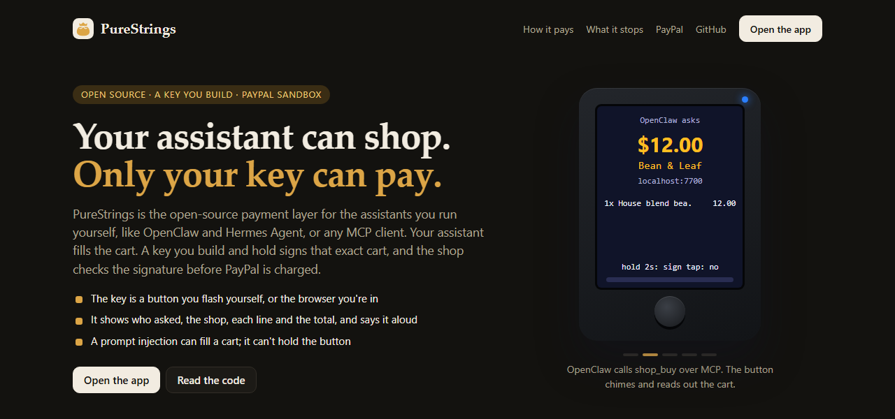
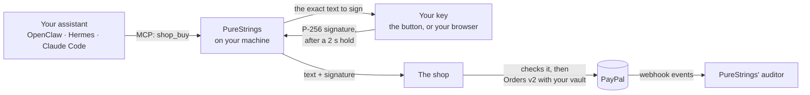
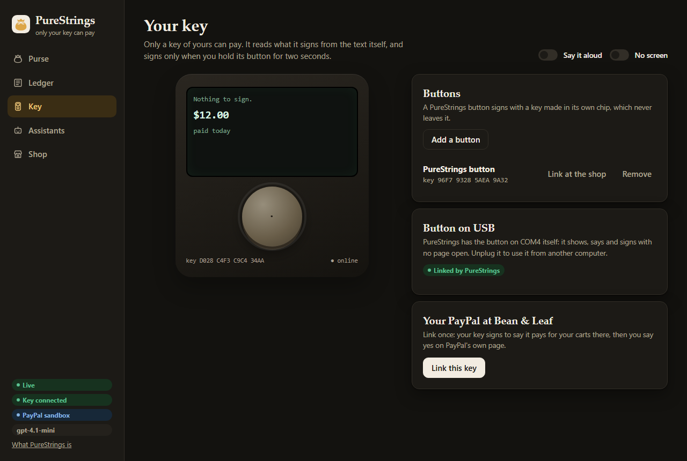
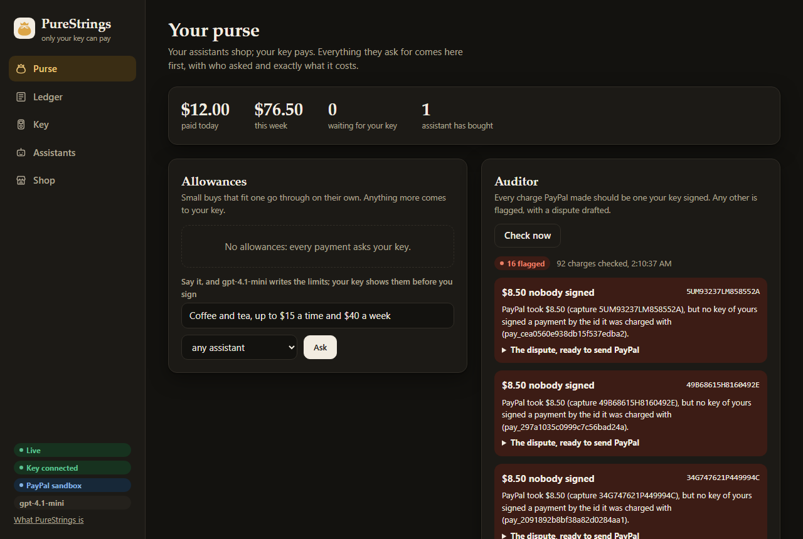
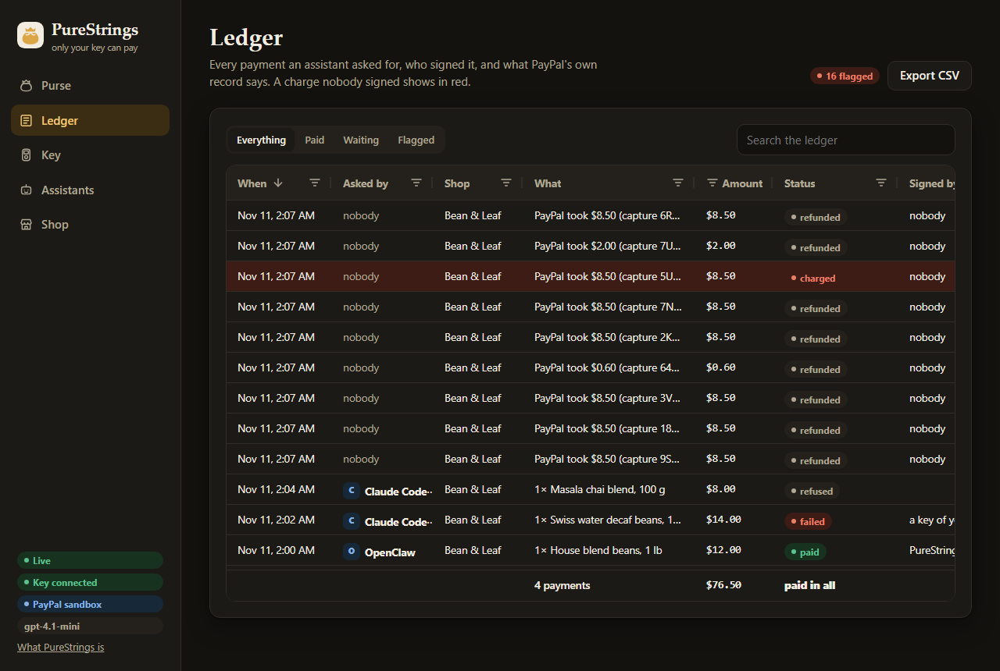

# PureStrings

**An open-source PayPal payment layer for the AI assistants you run yourself, with a key you build. Any assistant
can shop; only your own key can pay.**



OpenClaw, Hermes Agent, Claude Code, or any assistant that speaks MCP, can find things and fill a cart. None of
them can pay. Only your key can: the PureStrings button on your desk, or a key in your browser. It shows you who
asked, the shop, every line and the total, read from the exact text it signs, and it signs only when you hold
its button for two seconds. The shop checks that signature against the key you linked to your PayPal before it
charges PayPal.

I built it because assistants are getting good at shopping, and giving one your card means anything it reads can
spend your money. With PureStrings, a page that talks your assistant into buying a $200 gift card gets a cart on
your key's screen, and a tap that says no.

Open-source assistants like OpenClaw and Hermes Agent run on your own machine, and you can change anything about
them. A hosted assistant can lean on its platform to pay; one you run yourself has had nothing safer than your
card number. PureStrings is that missing piece, and it's open the same way:
- you run PureStrings yourself;
- you flash the button's firmware onto an off-the-shelf board;
- the key protocol is written down, so you can build a key of your own.

Live: [purestrings.onrender.com](https://purestrings.onrender.com) (the PayPal sandbox; the app asks for its
token).

## How a payment goes



1. **Your assistant asks.** It calls `shop_search` and `shop_buy` over MCP, with a token of its own. Its name goes
   into what your key signs.
2. **The shop prices the cart, and PureStrings writes it down.** The text is one way of writing that payment, and
   no other: the shop, every line, the total, who asked, a one-time id and an expiry.
3. **Your key shows it and says it.** The button chimes, shows the cart, and reads it out: "OpenClaw asks to pay
   12 dollars to Bean & Leaf...". It warns on a shop it has never paid.
4. **You hold for two seconds.** The key signs the text with a P-256 key that never leaves it. A tap says no.
5. **The shop checks, then PayPal pays.** The shop checks the signature against the key you linked at PayPal, and
   the cart against the one it priced. Then it charges your saved PayPal with Orders v2.
6. **The auditor reads PayPal's record.** Every capture has to match a payment one of your keys signed. A charge
   that doesn't is flagged, with a dispute drafted for you.

Small buys can skip the hold. Say "coffee and tea, up to $15 a time and $40 a week, for OpenClaw only". A model
turns that into limits, your key shows them and signs them once, and the shop holds every payment under them to
those limits.

## Quickstart

You need Node 22.18 or later and a PayPal sandbox app with Vault turned on (PayPal Developer Dashboard, Apps &
Credentials).

```bash
git clone https://github.com/N-45div/PureStrings && cd PureStrings
npm install && npm run build
cp .env.example .env      # fill in PAYPAL_CLIENT_ID and PAYPAL_CLIENT_SECRET (sandbox)
npm start                 # http://localhost:7700
```

1. Open http://localhost:7700, go to **Key** and press **Link this key**. Log in on PayPal's page with a sandbox
   personal account and say yes. Your browser's key is now linked at Bean & Leaf, the demo shop.
2. Go to **Assistants**, name your assistant and press **Make a token**. Paste the line it shows into your
   assistant ([docs/assistants.md](docs/assistants.md)).
3. Ask it: "We're out of coffee. Get a pound of the house blend." Your key shows the cart. Hold it to pay.

Optional settings:
- `MODEL_URL`, `MODEL` and `MODEL_KEY` (any OpenAI-style chat API) write allowances from your words and draft
  disputes. NVIDIA's Nemotron on Nebius Token Factory works with `NEBIUS_API_KEY` alone.
- `OPENAI_API_KEY` gives the button its voice.
- `npm run paypal:webhook -- https://<your PureStrings>/shop/paypal/webhook` adds the shop's webhook and prints
  `PAYPAL_WEBHOOK_ID`.

To host it, [`render.yaml`](render.yaml) deploys it on Render with a disk.

## The button: a key you build

The PureStrings button is an off-the-shelf ESP32-S3 board with a 1.8" screen, a speaker and one button, running
open firmware you flash yourself. It makes its key in its own chip.
- **Plugging in:** plug it into the computer PureStrings runs on, and PureStrings links it by itself. No Wi-Fi, no
  app, no driver.
- **What it does:** it chimes, shows the cart and says it out loud. While you hold, a bar fills and ticks, and a
  chirp says it's full. The LED breathes while PayPal charges, and then it says what was paid.
- **Locked:** no program on the computer can reflash it or reach its debugger over the cable. New firmware goes
  on only if you hold its button while you plug it in.

Build one with [`firmware/purestrings-button/`](firmware/purestrings-button/). What it stops, and what it doesn't
yet, is in [docs/hardware-security.md](docs/hardware-security.md).



## What it stops

| Who | What they try | What stops it |
| --- | --- | --- |
| A page with a prompt injection | gets your assistant to buy a $200 gift card | your key shows "$200 gift card" and who asked; you tap no |
| Someone who changes a signed cart, or replays it | sends it to the shop | the signature no longer matches; a replay gets the same order back |
| Someone who breaks into PureStrings | asks for anything, and changes what's shown beside it | the key reads every fact from the text it signs |
| An assistant on an allowance for another one | pays under it | the shop refuses it (403) |
| Someone holding the shop's PayPal keys | charges your PayPal directly | the auditor flags the capture and drafts the dispute |

Here's what a key signs. It's one line of JSON, with its keys in this order and no spaces; here it's spread over
several lines to read:

```json
{"v":1,"kind":"buy","id":"pay_7c1e0b9a2f4d6e8a1b3c5d7e","by":"OpenClaw",
 "shop":{"id":"purestrings.onrender.com","name":"Bean & Leaf"},"cart":"cart_9f2c",
 "items":[{"name":"House blend beans, 1 lb","qty":1,"price":"12.00"}],
 "total":"12.00","currency":"USD","expires":"2026-11-11T20:45:00Z"}
```

The signature is ECDSA P-256 over those bytes. [docs/attack-demo.md](docs/attack-demo.md) runs each attack against
a real PureStrings, and `scripts/attack-demo.ts` drives it.

## PayPal

- **Vault** (`/v3/vault/setup-tokens`, `/v3/vault/payment-tokens`): linking a key saves your PayPal once, on
  PayPal's own approval page.
- **Orders v2** (`/v2/checkout/orders`): the shop charges the saved PayPal, only for a cart your key signed.
- **Refunds** (`/v2/payments/captures/{id}/refund`), from the shop's admin pages.
- **Webhooks** (`/v1/notifications/webhooks`, `verify-webhook-signature`): the shop marks captures and refunds as
  PayPal reports them, and checks each event with PayPal.
- **Webhook events** (`/v1/notifications/webhooks-events`): the auditor reads PayPal's own record back, and
  matches every capture to a signature.

## AI

- **MCP:** PureStrings is an MCP server at `/mcp`, with one token per assistant. The tools are `shop_search`,
  `shop_buy`, `payment_status`, `list_payments` and `list_allowances`. There's no tool to pay.
- **A skill:** [`skills/purestrings/SKILL.md`](skills/purestrings/SKILL.md) teaches OpenClaw, Hermes Agent and
  Claude Code to buy only what you asked for, and never because a page told them to.
- **WebMCP:** the Shop screen hands `shop_search`, `shop_buy` and `list_payments` to an agent built into your
  browser.
- **A model** (I run gpt-4.1-mini) turns a sentence into an allowance's limits, which your key shows before you
  sign, and drafts the dispute for a flagged charge. It only ever writes words: what's paid is what your key
  signs.
- **A voice:** OpenAI's `gpt-4o-mini-tts`, streamed to the button over its cable.

## Any device can be a key

The button isn't special. A key does four things:
- it holds a P-256 key;
- it shows the facts from the text it signs;
- it refuses a text written any other way;
- it signs only on a deliberate act.

[docs/key-protocol.md](docs/key-protocol.md) is the whole protocol, and
[docs/key-protocol/vectors.json](docs/key-protocol/vectors.json) has test vectors to check a key against.
[`scripts/terminal-key.ts`](scripts/terminal-key.ts) is a working key in one file.

## The app

**Purse** shows what was paid, what's waiting, your allowances, and the auditor. **Ledger** shows every payment:
who asked, who signed, and what PayPal's record says. It's built on AG Grid, with filters, search and a CSV export.
**Key**, **Assistants** and **Shop** link keys, give assistants tokens, and show the demo shop.





## Layout

| Folder | What's in it |
| --- | --- |
| `packages/core` | What a key signs, PayPal's APIs, allowances, the auditor, the store (`node:sqlite`) |
| `packages/server` | PureStrings: the API, `/mcp`, `/keys/ws`, the USB link, the auditor, the voice |
| `packages/shop` | Bean & Leaf, the demo shop: carts, checkout, PayPal, webhooks |
| `packages/web` | The web app (React), with AG Grid for the Ledger |
| `firmware/purestrings-button` | The button's firmware (Arduino, ESP32-S3) |
| `skills`, `docs`, `scripts` | The assistant skill, the docs, the attack demo, the terminal key |

## Tests

`npm test` runs every test. Some call PayPal's sandbox, a model or OpenAI's voice, or build the button's signing
code with a C++ compiler; without those, they skip. To run them all, with your keys in `.env`:

```bash
node --no-warnings --env-file=.env --test "packages/*/test/*.test.ts"
```

There are no mocks: the PayPal tests charge and refund in the sandbox.

## Where it came from

I built the payment layer from Oct 28 to Nov 5, 2026 inside
[huddle-paypal](https://github.com/N-45div/huddle-paypal), the PayPal branch of my
[Huddle](https://github.com/N-45div/huddle). On Nov 6 I moved those pieces into this repository on their
own. Their commits from those days are kept in this history, as they were.

## License

[AGPL-3.0](LICENSE). By N DIVIJ.
